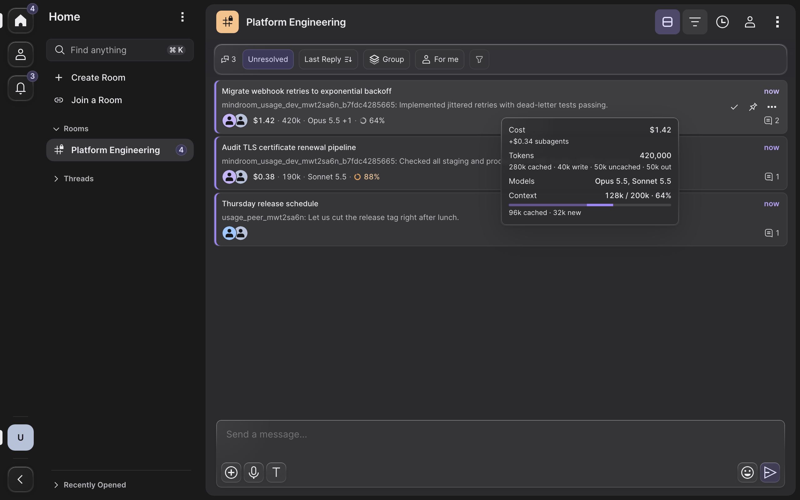
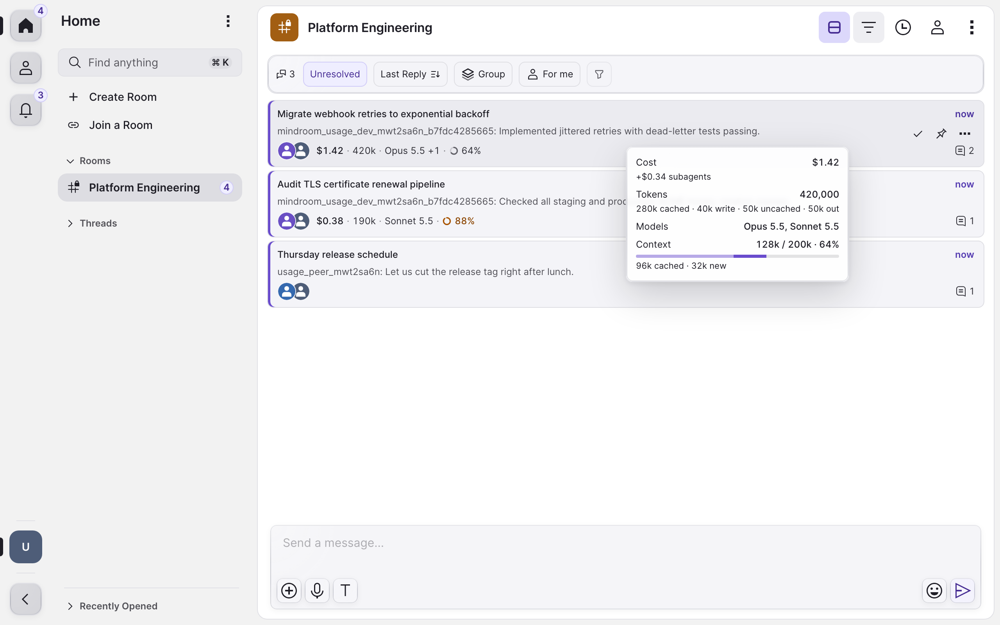
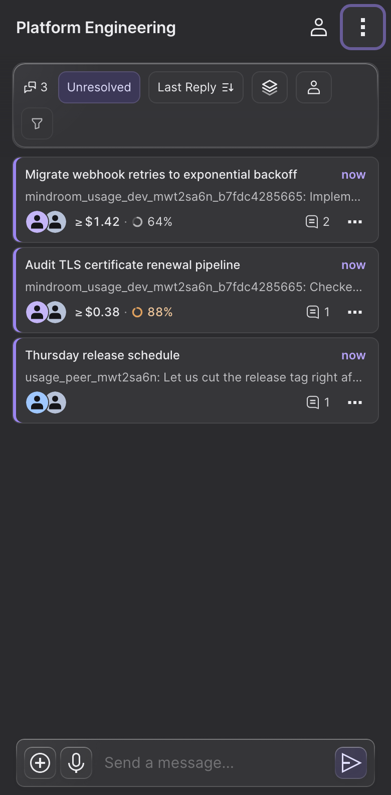
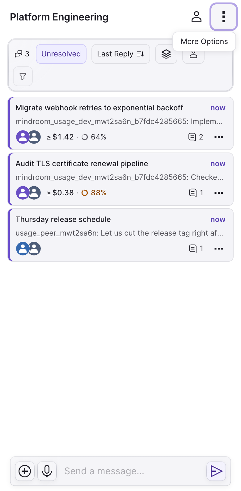

# Thread Usage

[](LICENSE)
[](https://github.com/mindroom-ai/thread-usage-client-plugin/actions/workflows/ci.yml)
[](https://github.com/mindroom-ai/mindroom-chat/blob/main/docs/client-plugins.md)

<picture>
  <source media="(prefers-reduced-motion: no-preference)" srcset="https://raw.githubusercontent.com/mindroom-ai/mindroom/main/assets/logo/logo-mark-animated.svg" />
  
</picture>

A [MindRoom Chat](https://github.com/mindroom-ai/mindroom-chat) client plugin that shows per-thread AI **cost**, **tokens**, **models used**, and **context window fill** right on Compact thread cards and in thread details — with zero runtime dependencies and zero backend changes.

At a glance on every AI thread card: `$1.42 · 420k · Opus 5.5 +1 · ◔ 64%` (with the context ring shifting to amber at `≥ 75%` and red at `≥ 90%`). Hover a card, open its thread menu, or hover the sidebar thread row to see the full breakdown.

## Screenshots

| Desktop (dark, with hover details)                                  | Desktop (light, with hover details)                                   |
| ------------------------------------------------------------------- | --------------------------------------------------------------------- |
|  |  |

| Phone 390px (dark)                             | Phone 390px (light)                              |
| ---------------------------------------------- | ------------------------------------------------ |
|  |  |

## Why it's useful

- **Spot expensive threads before opening them:** Total spend (including subagents) and token volume sit quietly in the card's metadata row without extra pill clutter.
- **See context pressure across a whole room:** A micro progress ring shows how full the latest reply's context window is, turning amber at `≥ 75%` and red at `≥ 90%` so you know which threads are nearing compaction.
- **Know which models worked on a thread:** Shows the latest model plus `+N` when multiple models contributed, with the full list in thread details.
- **Mobile-ready & unobtrusive:** On phone viewports, cards condense to cost and context fill (`≥ $1.42 · ◔ 64%`) so they fit cleanly beside avatars, reply counts, and the menu button. Human-only threads show nothing.
- **Clean example plugin template:** Demonstrates `threadCardBadges`, `threadDetails`, `usePluginConfig`, `useScreenSize`, theme-safe styling across all 23 MindRoom Chat palettes, and live Matrix event subscriptions with zero runtime dependencies.

## Quick start

Official [MindRoom Chat](https://github.com/mindroom-ai/mindroom-chat) builds (web, Mac, iOS, and Docker) **bundle this plugin by default**, so you do not need to install or build anything to use it. Use the steps below only for custom builds or local development.

### 1. Build MindRoom Chat with this plugin

Clone this repository alongside [mindroom-chat](https://github.com/mindroom-ai/mindroom-chat), install it once, and pass its absolute path via `MINDROOM_CLIENT_PLUGINS`:

```bash
git clone https://github.com/mindroom-ai/thread-usage-client-plugin.git
cd thread-usage-client-plugin
npm ci

cd /path/to/mindroom-chat
MINDROOM_CLIENT_PLUGINS=/abs/path/to/thread-usage-client-plugin npx vite build
```

For Docker builds, copy the plugin into your build context and pass the build argument:

```bash
docker build -f docker/Dockerfile \
  --build-arg MINDROOM_CLIENT_PLUGINS=/src/plugins/thread-usage-client-plugin \
  -t mindroom-chat .
```

To bundle multiple plugins together, separate their paths with commas (for example, `pull-request-client-plugin` and `thread-usage-client-plugin`). Requires MindRoom Chat client SDK `66` or later.

### 2. Configure in `config.json` (optional)

Everything is enabled by default. To customize which segments appear on Compact cards — or turn the plugin off for a deployment — add a `plugins["thread-usage"]` block to MindRoom Chat's `config.json`:

```json
{
  "plugins": {
    "thread-usage": {
      "enabled": true,
      "showCost": true,
      "showTokens": true,
      "showModels": true,
      "showContext": true
    }
  }
}
```

## Settings

| Setting       | Default | Description                                                               |
| ------------- | ------- | ------------------------------------------------------------------------- |
| `enabled`     | `true`  | Set to `false` to disable both the Compact card strip and thread details. |
| `showCost`    | `true`  | Show total conversation cost on Compact cards.                            |
| `showTokens`  | `true`  | Show compact total token count on Compact cards.                          |
| `showModels`  | `true`  | Show the most recent model (and `+N` count) on Compact cards.             |
| `showContext` | `true`  | Show the micro context-window ring and percentage on Compact cards.       |

Toggling individual `show*` options hides them on the card while keeping the full breakdown available in thread details (hover card, thread menu, and sidebar hover card).

Users can also toggle the plugin per-account in **Settings → Plugins** (synced across web, Mac, and iOS), unless it is disabled deployment-wide via `config.json`.

<details>
<summary><b>How it works &amp; partial history (≥)</b></summary>

- **Data source:** Reads `io.mindroom.ai_run` (`version: 1`) metadata emitted by trusted MindRoom agents on the viewer's homeserver (skipping ignored users and redacted messages), including live streamed `m.replace` edits, server-bundled edits, encrypted-room decryptions, and bundled `thread.rootEvent` / `thread.replyToEvent` summaries on unopened threads.
- **Exact vs. lower-bound totals:** Threads in a room overview may not have every older page loaded in memory yet, and a reply that ended as `cancelled`, `error`, or `interrupted` may omit `cost.usd`.
  - When full thread history back to the root is loaded and every terminal reply has known cost, totals render as exact figures (`$1.42`, `420k`).
  - Otherwise, cost and token totals render as lower bounds (`≥ $0.08` on cards, `At least $0.08` in details; `≥ 48k`), floored at the displayed precision so a lower bound never claims more than was counted.
- **Context &amp; latest model:** Always reflect the latest agent reply that reported them, even on unopened threads.
- **Low overhead:** All mounted cards in a room share a single multiplexed Matrix room/client event subscription, keeping listener counts bounded regardless of how many threads are visible.

</details>

<details>
<summary><b>Development, tests &amp; screenshots</b></summary>

Link a local `mindroom-chat` checkout with installed `node_modules` at `.mindroom-chat`:

```bash
ln -s /path/to/mindroom-chat .mindroom-chat
```

Typecheck, strict check, lint, and formatting (from this repository):

```bash
npm run typecheck
npm run strict
npm run lint
.mindroom-chat/node_modules/.bin/prettier --check src e2e README.md package.json tsconfig.json tsconfig.strict.json
```

Unit tests and production build (from `.mindroom-chat`):

```bash
MINDROOM_CLIENT_PLUGINS=/abs/path/to/thread-usage-client-plugin \
  MINDROOM_CLIENT_PLUGIN_TESTS_ONLY=1 npx vitest run

MINDROOM_CLIENT_PLUGINS=/abs/path/to/thread-usage-client-plugin \
  npx vite build
```

Playwright end-to-end tests and screenshot capture (from `.mindroom-chat`):

```bash
E2E_PLUGIN_DIRS=/abs/path/to/thread-usage-client-plugin \
MINDROOM_CLIENT_PLUGINS=/abs/path/to/thread-usage-client-plugin \
MRTU_SHOTS=/abs/path/to/thread-usage-client-plugin/docs/screenshots \
  just e2e-slot 3 --preview npx playwright test --project=thread-usage-client-plugin
```

`MRTU_SHOTS` also outputs `desktop-light.png` and `desktop-dark.png` alongside the four committed `hover-*` and `phone-*` shots.

</details>
